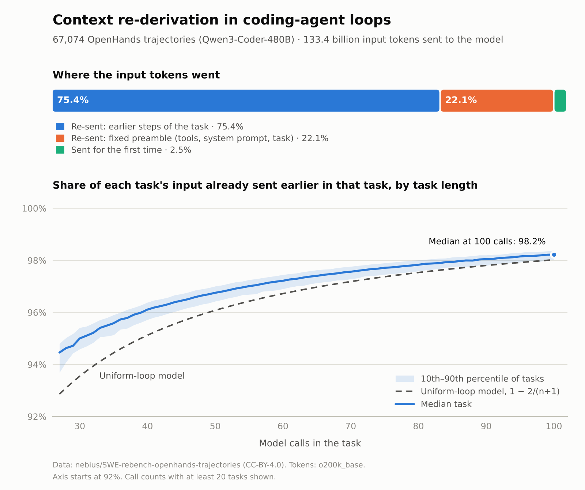

# Context re-derivation frequency

**How much of what an AI agent sends to the model has it already sent before?** This repository measures it
on 67,074 public coding-agent trajectories, in Python and DuckDB SQL. It is the Tier 0 measurement for
[*The Constraint Premium*](https://shivshankarsingh.com/research/), a thesis arguing that as AI inference
gets cheap, the cost that matters in an agentic enterprise is context: meaning re-derived on every execution
instead of defined once.

<picture>
  <source media="(prefers-color-scheme: dark)" srcset="results/rdf_vs_calls_dark.png">
  
</picture>

## Results

<!-- After your run, replace this comment with the bullet list under "Paste into README → Results" in results/summary.md. -->

Full figures and tables: [results/summary.md](results/summary.md).

## The metric

**Context re-derivation frequency (RDF)** is the share of a task's input tokens that the agent had already
sent earlier in the same task:

```
RDF = re-sent input tokens / all input tokens        (per task)
```

In an append-only loop of *n* model calls that each add *k* new tokens, input across the task totals
*k·n(n+1)/2* tokens, of which *k·n* are new, so **RDF = 1 − 2/(n+1)**: 82% at 10 calls, 96% at 50. The thesis
states this as a derivation; this repository measures it. (RDF here is not W3C RDF, the Resource
Description Framework.)

Its companion, **context-assembly cost share (CACS)**, is the share of spend that re-sent input costs at the
price the provider actually charged. Without billing data, this repository *models* CACS under stated price
ratios; the thesis's next tier reconciles it against provider bills.

## Data

[nebius/SWE-rebench-openhands-trajectories](https://huggingface.co/datasets/nebius/SWE-rebench-openhands-trajectories):
67,074 runs of the OpenHands agent (v0.54.0) with Qwen3-Coder-480B-A35B-Instruct on real GitHub issues
from 1,823 repositories, up to 100 model calls each. The OpenHands configuration published with the dataset
uses the no-op condenser with history truncation off and native tool calling, so every model call received
the full history plus the tool definitions. That is the loop this repository replays.

Trofimova, M., Shevtsov, A., Badertdinov, I., Pyaev, K., Karasik, S. and Golubev, A. (2025).
*OpenHands Trajectories with Qwen3-Coder-480B-A35B-Instruct.* Nebius blog. Licensed CC-BY-4.0.

## Method

1. **Count (Python, [`rdf_tier0.py`](rdf_tier0.py)).** Each message's text, its content plus any tool call's
   name and arguments, is tokenized once. The five tool definitions sent with every call are counted once
   per task.
2. **Replay (SQL, [`sql/rdf.sql`](sql/rdf.sql)).** A window function sums the message history in front of
   every assistant message, which is one model call. A token is new input the first time a call sends it and
   re-sent input on every later call; messages after the last call count nowhere.
3. **Check.** Before touching real data, the same SQL runs on 200 synthetic loops whose RDF is known in
   closed form and must match to within 10⁻¹². Unit tests cover a hand-worked task and edge cases.

Tokens are counted with `o200k_base` (tiktoken). On a 1,538-task check, switching to the generating model's
own tokenizer (`--tokenizer qwen`, about three times slower) moved pooled RDF by less than 0.01 points and
the median task's RDF by 0.01 points.

## Run it

**Google Colab, no install.** Open [`notebooks/rdf_tier0_colab.ipynb`](notebooks/rdf_tier0_colab.ipynb) in
[Colab](https://colab.research.google.com/) and choose *Runtime → Run all*. The full run takes about
30 minutes on the free CPU; set `SAMPLE_FRAC = 0.05` for a 3-minute trial.

**Locally** (Python 3.9+, about 3 GB of free disk):

```bash
pip install -r requirements.txt
python rdf_tier0.py selfcheck               # the SQL against the closed form
python rdf_tier0.py run --sample-frac 0.05  # a 5% trial
python rdf_tier0.py run                     # all 67,074 tasks
pytest -q
```

Outputs land in `results/`:

| File | What it holds |
|---|---|
| `summary.md`, `summary.json` | Headline figures and tables |
| `rdf_vs_calls.png`, `rdf_vs_calls_dark.png` | The chart above |
| `rdf_by_calls.csv` | RDF percentiles by number of model calls: the chart as a table |
| `tasks.parquet` | One row per task: calls, input, new, re-sent and output tokens, RDF, modeled CACS |

## Limits

- **Replay, not billing.** The counts reconstruct what an append-only loop sends; they are not provider
  invoices, and chat-template tokens (role markers and the like) are not counted.
- **One harness, one model, one domain.** OpenHands and Qwen3-Coder on coding tasks. The enterprise
  workflows the thesis is about are not measured here.
- **Loop length does most of the work in an append-only harness.** Harnesses that condense, truncate or
  retrieve context are where RDF should separate designs; comparing them is the next tier.
- **CACS is modeled**: perfect prefix caching, cache reads at 0.1× and writes at 1.25× the fresh-input
  price, output at 5×. Real caches expire and miss.

## About

By [Shiv Shankar Singh](https://shivshankarsingh.com). The thesis and its executive brief are at
[shivshankarsingh.com/research](https://shivshankarsingh.com/research/).

AI use: the code was drafted with Claude (Anthropic) from the metric definitions in the thesis; the author
reviewed it, ran it and takes responsibility for the results.

Code: MIT License. Data: CC-BY-4.0, Nebius. Keep the attribution above when reusing the results.
