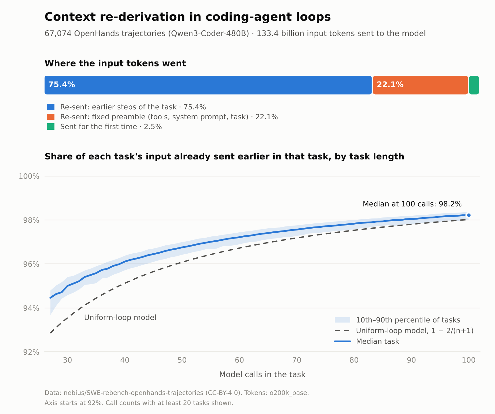

# Results: context re-derivation frequency, Tier 0

Run 2026-11-04 (UTC) · 67,074 of 67,074 tasks measured · sample fraction 1 (seed 7) · tokens: o200k_base (tiktoken) · runtime 53 min

## Paste into README → Results

- Across 67,074 tasks, the agent sent the model 133.4 billion input tokens; 97.5% of them had already been sent earlier in the same task.
- The median task made 61 model calls and had an RDF of 97.2% (10th–90th percentile 96.2%–98.1%).
- The closed form 1 − 2/(n+1), derived for a loop that adds equal new context per call, comes within 0.5 percentage points of the median task's measured RDF (measured is higher).
- At a given number of calls RDF barely varies: the 10th and 90th percentile tasks sit 0.5 percentage points apart, so loop length alone predicts it.
- The fixed preamble (tool definitions, system prompt and task statement, sent with every call) accounts for 22.7% of all re-sent tokens.
- Resolved tasks: median 56 calls, RDF 97.0%; not resolved: median 67 calls, RDF 97.4%.
- Modeled cost share (CACS): re-sent input is 94.3% of spend with no caching and 59.7% with perfect prefix caching (cache reads at 0.1×, writes at 1.25×, output at 5× the fresh-input price). Caching changes the price of a re-sent token, not how often it is sent.

## By outcome

| Outcome | Tasks | Median calls | Median RDF | p10 | p90 | Median input tokens |
|---|---:|---:|---:|---:|---:|---:|
| resolved | 32,161 | 56 | 97.0% | 96.1% | 97.9% | 1,475,366 |
| not resolved | 34,913 | 67 | 97.4% | 96.4% | 98.2% | 2,013,700 |

## By task length

| Model calls | Tasks | Median RDF | p10 | p90 | Uniform-loop model |
|---|---:|---:|---:|---:|---:|
| 11-25 | 17 | 93.5% | 91.2% | 94.3% | 92.0% |
| 26-50 | 17,401 | 96.4% | 95.6% | 96.8% | 95.6% |
| 51-75 | 32,271 | 97.2% | 96.8% | 97.7% | 96.8% |
| 76+ | 17,385 | 98.0% | 97.7% | 98.3% | 97.8% |

## Checks

- RDF counting messages only (tool definitions left out): median 97.1%.
- Tool definitions sent with each call: 3,281 tokens.
- Per-call-count table: `rdf_by_calls.csv`. Per-task table: `tasks.parquet`.

